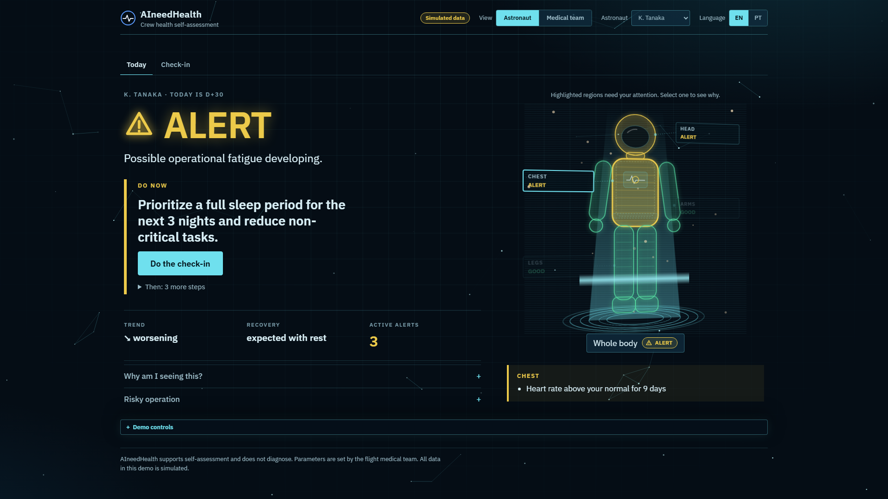
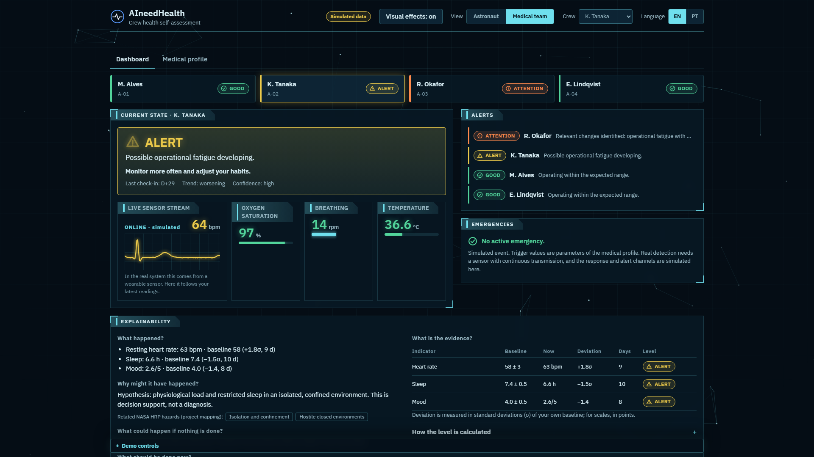

# AIneedHealth

**Crew health self-assessment and decision-support prototype for long-duration spaceflight.**

Built for the NASA Space Apps Challenge 2026, challenge 3/9: *Create Health Monitoring Software for Astronauts on Space Missions*.

[Live demo](https://aineedhealth.vercel.app) · [Video assets](video/README.md) · [Contributing](CONTRIBUTING.md)

> **Simulated data, not a medical device.** The prototype runs on simulated readings and a simulated sensor stream. It has not been clinically validated and it does not diagnose. See [Limitations](#limitations).





---

## Overview

Missions beyond low Earth orbit face communication delays of up to about 20 minutes one way to Mars, and no immediate medical support on board. A physiological change can grow into an emergency before anyone on the ground can respond.

AIneedHealth helps an astronaut judge their own condition and decide what to do next, and gives the flight medical team an explainable view of the same situation. It does not simply display vital signs. For every reading, the system:

- compares the value with the **astronaut's own baseline**, set by the flight medical team;
- applies **absolute safety limits**, confirmed by consecutive readings;
- correlates concordant signals into **patterns** (operational fatigue, dust exposure after an EVA, cardiovascular response);
- assigns one of **four levels** and explains it: what happened, why, the evidence, what happens if nothing is done, and what to do now.

## Features

- **Two role views.** The *Astronaut* view shows one status, one main action, the trend, recovery and active alerts. The *Medical team* view adds the crew board, explainability, temporal evolution, a rule-based projection, the event log and the medical profile.
- **Daily check-in** with input validation and a streak counter.
- **Body map.** Regions light up when they need attention; selecting one shows the indicators behind it.
- **Explainability.** Each classification lists its evidence and the rule that produced it.
- **Emergency flow.** A simulated incapacitation detector moves through *suspect* → *confirmation countdown* → *declared*, then notifies the crew and mission control.
- **Long-term capacity.** Aerobic, strength, bone and radiation-dose checks are shown as a separate seal, referenced to NASA-STD-3001 Volume 1 Rev C.
- **English and Portuguese** interface, switchable at any time.
- **No backend.** The app is a single static page; all logic runs in the browser.

## Classification levels

| Level | Colour | Produced by |
| --- | --- | --- |
| GOOD | Green | No relevant deviation |
| ALERT | Yellow | Route A: moderate, persistent deviation from the personal baseline |
| ATTENTION | Orange | Route A: significant deviation, or Route B: absolute limit, first reading |
| CRITICAL EMERGENCY | Red | Route B: absolute limit confirmed on two readings, or the emergency protocol |

## How it works

- **Route A: trend.** Each indicator is compared with the individual baseline in standard deviations (or in points, for ordinal scales). A level is entered only after the deviation persists for 3 days, and it is left only after the deviation falls back below a lower threshold for 2 days (hysteresis).
- **Route B: safety.** Absolute limits act immediately. The first reading raises attention and asks for a repeat; two consecutive readings confirm the limit.
- **Patterns.** Two or more concordant indicators activate one of three patterns: *operational fatigue* (heart rate, sleep, mood), *dust exposure* (eye, cough and skin symptoms after an EVA) or *cardiovascular response* (blood pressure and heart rate). Confidence grows with the number of concordant indicators.
- **Emergency detection.** Based on a simulated sensor stream (heart rate, motion and signal quality) with a verification step. Sleep and sensor loss never trigger an emergency on their own.
- **Medical profile.** Every threshold is a parameter of the profile that the flight medical team sets. The values in this repository are demonstration values.

The engine is documented in `src/engine.js`, and its behaviour is covered by the tests in `test/`.

## Quick start

Requirements: Node.js 18 or later.

```bash
npm run build   # writes dist/index.html and dist/artifact.html
npm test        # engine tests (node:test, no dependencies)
```

Open `dist/index.html` in any modern browser. No server is required. The only external resource is the IBM Plex Sans font from Google Fonts.

The repository is deployed as a static site: `vercel.json` builds the project and publishes `dist/`.

## Project structure

```
src/engine.js          Classification engine (pure functions, no DOM)
src/i18n.js            English (default) and Portuguese strings
src/fx.js              Visual effects: grid, ECG trace, dust particles, count-up, scan
src/app.js             Application: state, views, emergency flow
src/style.css          Styles and design tokens
src/body.html          Page markup
build.mjs              Inlines CSS and JavaScript into dist/
test/engine.test.js    Engine tests
docs/screenshots/      Screenshots used in this README
video/                 Remotion project and tooling for the pitch and social videos
```

## Video assets

The `video/` folder contains the Remotion project that produced the 30-second pitch video and the other promotional cuts, including narration, sound design and the data pipeline that feeds the video with real engine output. See [video/README.md](video/README.md).

## Limitations

- **Simulated data.** The readings and the sensor stream are simulated. No real device is integrated.
- **Not validated.** Thresholds, sigma cut-offs and persistence windows are project parameters, not NASA values. They have not been validated by clinicians.
- **Standard scope.** NASA-STD-3001 Volume 1 does not define numeric vital-sign limits, so limits must come from the medical team. NASA-STD-3001 Volume 2 was not reviewed for this prototype.
- **Statistical assumptions.** The false-alarm analysis assumes independent, Gaussian noise. Real physiological data is autocorrelated and will raise more alarms than the tests suggest.
- **Not an operational link.** The Bluetooth architecture is a proposal. A NASA Space Station report (9 March 2026) describes sensor data sent through a Bluetooth adaptor to a laptop; the end-to-end path shown in the prototype is not an operational NASA system.

## Sources

- NASA-STD-3001, *NASA Space Flight Human-System Standard*, Volume 1: Crew Health, Revision C (medical profile and long-term capacity requirements).
- NASA Human Research Program: hazards and risk documentation, including the Clinical Decision Support project.
- Canadian Space Agency (CSA), Bio-Monitor documentation.
- NASA, *Spacewalk Preps and Health Checks Using Augmented Reality and Artificial Intelligence*, Space Station blog, 9 March 2026.

## Team

Clara Beatriz, Matheus Ryan, Cauã Mesquita and Álvaro Boaventura.

## Contributing

Contributions are welcome. Read [CONTRIBUTING.md](CONTRIBUTING.md) before opening a pull request.

## License

No license has been selected yet. Until one is added, all rights are reserved by the authors.
